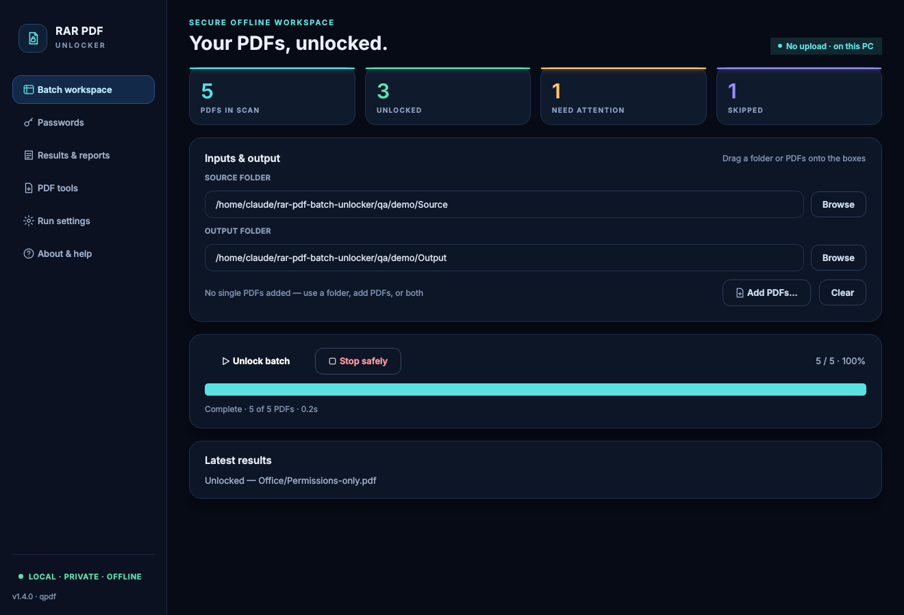
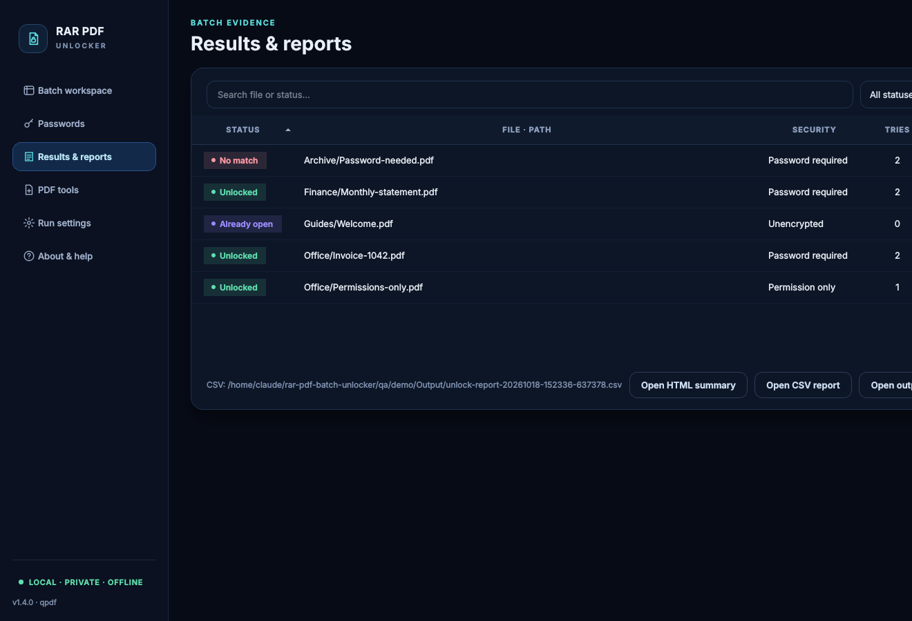
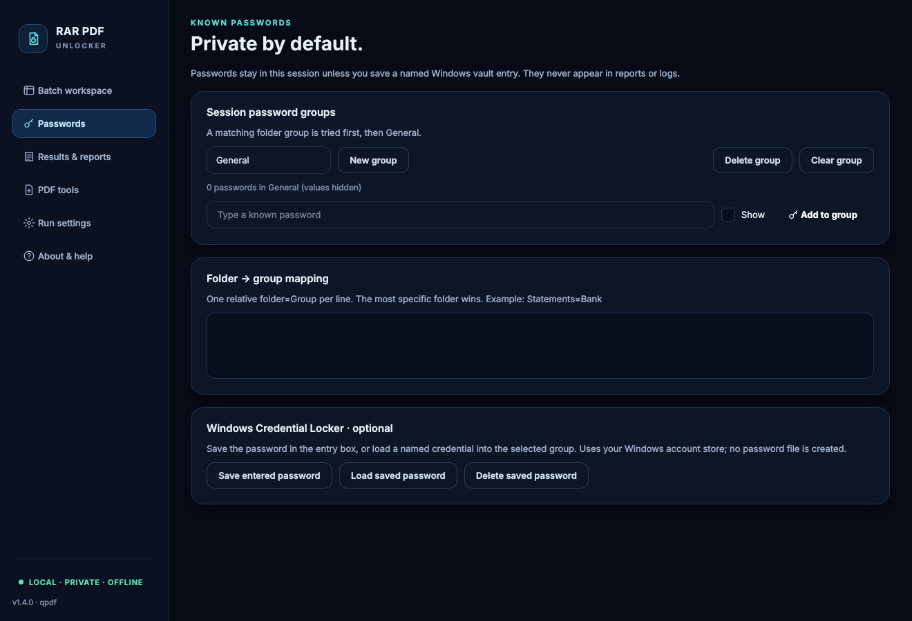
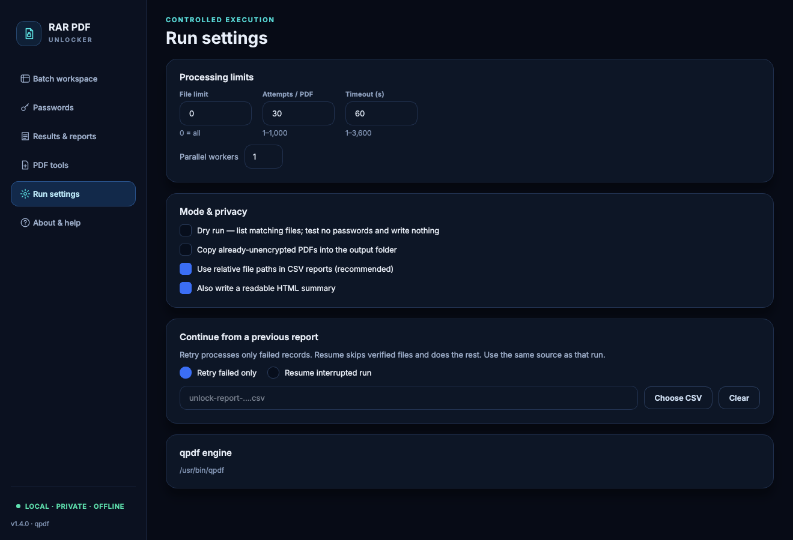
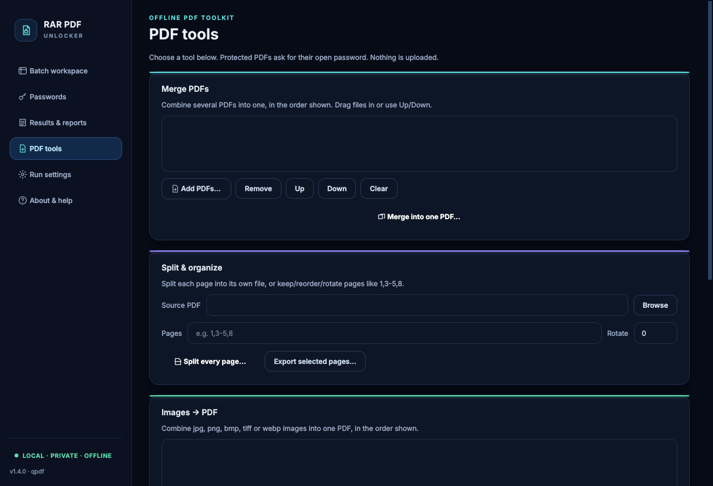

# RAR PDF Batch Unlocker

**Unlock many password-protected PDFs at once — offline, on your own Windows PC, using passwords you already know.**
**নিজের PC-তে, internet ছাড়াই, জানা password দিয়ে একসাথে অনেক PDF unlock করুন।**

[](https://github.com/ruhulaminrevens/RAR-PDF-Batch-Unlocker/actions/workflows/windows-release.yml)
[](https://github.com/ruhulaminrevens/RAR-PDF-Batch-Unlocker/releases/latest)


## Download

| Platform | Download | Notes |
| --- | --- | --- |
| **Windows 10/11 (64-bit)** | **[⬇ RAR-PDF-Batch-Unlocker-Setup.exe](https://github.com/ruhulaminrevens/RAR-PDF-Batch-Unlocker/releases/latest/download/RAR-PDF-Batch-Unlocker-Setup.exe)** | Latest version · [SHA-256](https://github.com/ruhulaminrevens/RAR-PDF-Batch-Unlocker/releases/latest/download/SHA256SUMS.txt) · [Release notes](https://github.com/ruhulaminrevens/RAR-PDF-Batch-Unlocker/releases/latest) |
| Android | Not available yet | Planned; no APK has been published |

No Python or qpdf install is needed. Installing over an older version upgrades it in place.
The installer is **not code-signed**, so Windows SmartScreen may show *More info → Run anyway*. Check the SHA-256 if you want to be sure the file is genuine.



## Quick start · দ্রুত শুরু

1. **Inputs** — choose a **Source folder**, or click **Add PDFs…**, or both.
   Source folder বেছে নিন, অথবা **Add PDFs…** দিয়ে আলাদা file যোগ করুন।
2. **Output folder** — choose a separate, empty folder. Originals are never changed.
   আলাদা একটি output folder দিন; মূল file অপরিবর্তিত থাকে।
3. **Passwords** — add the passwords you know. You can group them (e.g. *Bank*, *Office*) and map folders to groups.
   জানা password যোগ করুন; চাইলে group ও folder mapping করুন।
4. **Analyze security** (optional), then **Unlock batch**. Check the summary and confirm.
   চাইলে আগে **Analyze security** দিন, তারপর **Unlock batch** চাপুন।
5. **Results & reports** — filter, sort and open the CSV or HTML summary. You can **retry** failed files or **resume** a stopped run.
   ফলাফল দেখুন; ব্যর্থ file আবার চালান বা থেমে যাওয়া run resume করুন।

Tip: for the first run, set **File limit = 5** in *Run settings*.

## Features

| | |
| --- | --- |
| **Fully offline** | No upload and no internet use. All processing runs on your PC with the bundled qpdf engine. |
| **Batch input** | A whole folder tree, individually selected PDFs, or both. Duplicates and non-PDF files are left out. |
| **Password groups** | Session passwords, which are not saved by default, plus folder → group mapping. Optional **Windows Credential Locker** save/load, only when you click it. |
| **Safe output** | Each copy is verified with `qpdf --check`, then published atomically. Existing files are never overwritten. |
| **Clear results** | Unlocked · No password match · Already unencrypted · Invalid PDF · File locked · Disk full · Path too long, and more. Each comes with a suggested next step. |
| **Reports** | A CSV, safe to open in Excel, plus a JSON run record and an HTML summary with the app and engine versions. |
| **Fast** | 1–16 parallel workers. On the CI machine, 1,000 PDFs took 51 s with 4 workers. |
| **Control** | Dry run, Analyze only, file limit, attempts per PDF, timeout, Stop at any moment, retry failed, resume. |
| **Windows-ready** | Bangla and long file paths, 100–200 % display scaling, Start Menu and Desktop shortcuts, clean uninstall. |

## Privacy and safety

- Passwords reach qpdf only through standard input. They never appear on the command line or in reports, logs or screenshots.
- Original PDFs are opened read-only. Outputs go to a separate folder and are never written over an existing file.
- Unlocked PDFs are still sensitive, so keep the output folder access-controlled.
- **Use it only on PDFs you are authorized to open.** It tries only the passwords you supply. It cannot recover a strong password you do not know, and it has no brute-force feature.
- Rewriting a digitally signed PDF can invalidate its signature, so keep the signed original.

## Screenshots

<details>
<summary>Results, passwords, run settings and PDF tools</summary>






These are renders of the v1.4.0 interface, using synthetic test PDFs only. Real installed-EXE Windows captures of the same interface (validated at the redesign baseline) are in [docs/SCREENSHOTS.md](docs/SCREENSHOTS.md).
</details>

## Troubleshooting

| Problem | What to do |
| --- | --- |
| SmartScreen warning | The installer is unsigned. Choose *More info → Run anyway*, or verify the SHA-256 first. |
| **No password match** | None of your passwords opened the file. Add the right one, then use **Retry failures**. |
| **Output exists** | A file with that name is already in the output folder. Move it, or choose another output folder. |
| **File locked** | Close the PDF in your viewer or other program, then retry. |
| **Invalid PDF** | The file is damaged, incomplete or not really a PDF. Try opening it in a PDF viewer. |
| **Disk full** | Free some space on the output drive, then **Resume**. |
| App closed during a run | Choose the run's report in *Run settings → Continue from a previous report → Resume*. |
| Unexpected error | Details, with passwords removed, are in `%LOCALAPPDATA%\RAR PDF Batch Unlocker\logs`. |

## Quality

Every release is built and tested on Windows by GitHub Actions before it is published. The tests cover the following:

- 52 automated tests with the real engine, including long paths, locked files, interrupted writes, resume and password privacy.
- The real installed app processing a test batch through actual mouse and keyboard input.
- Upgrade from the previous version, and a clean uninstall.
- A 100 and 1,000-PDF benchmark.

The published installer is the exact file that passed these checks. See [docs/validation/v1.2.0.md](docs/validation/v1.2.0.md).

**Still needs testing on real PCs:** physical 125/150/200 % display scaling, Windows 10, antivirus and SmartScreen behaviour, and your own real-world PDFs.

## For developers

```bat
python -m pip install -r requirements-build.txt -r requirements-test.txt
python -m unittest discover -s tests -v
python app.py
```

- `core.py` is the engine wrapper: planning, inspection, decryption, verification and reports.
- `app.py` and `ui.py` are the Tkinter GUI.
- `reports.py` writes the HTML summary.
- `vault.py` handles the optional Windows Credential Locker.
- `diagnostics.py` writes the redacted log.

`build-windows.bat` builds the app locally. Releases are only promoted from a successful Windows Actions run and are never rebuilt. The licences of bundled components are in [THIRD-PARTY-NOTICES.txt](THIRD-PARTY-NOTICES.txt).

---
Maintainer: [ruhulaminrevens](https://github.com/ruhulaminrevens) · Issues: please never attach confidential PDFs or real passwords.
